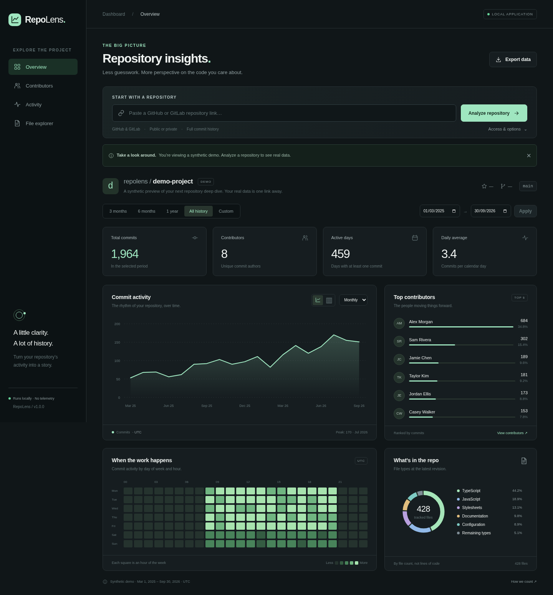

# RepoLens

**A little clarity. A lot of history.**

Explore GitHub and GitLab repositories through a clean, local analytics dashboard. Paste a repository link, pick a period, and turn its commit history into charts you can actually use.

**Python 3.10+ · Git 2.27+ · No runtime packages · AGPL-3.0-only licensed**



_The screenshot uses clearly labeled synthetic demo data, not a private or live repository. All example contributor names are fictional._

## What it can do

| View              | Insights                                                                       |
| ----------------- | ------------------------------------------------------------------------------ |
| **Overview**      | Commit totals, contributor counts, active days, daily average, area/bar charts |
| **Contributors**  | Top authors, commit counts, and their share of activity                        |
| **Activity**      | Commit trends, day/hour heatmap, and weekday totals                            |
| **File explorer** | Latest tracked-file type distribution and repository details                   |

- **GitHub and GitLab:** public repositories, optional tokens for private repositories, and public self-hosted GitLab instances.
- **Flexible history:** daily, weekly, or monthly grouping; all history, recent periods, or custom inclusive date ranges.
- **Meaningful filters:** optionally exclude merges; display empty buckets rather than hiding quiet periods.
- **Useful context:** stars, forks, default branch, license, and issue count when the provider API makes them available.
- **Portable results:** export CSV for the current view.
- **Fast repeat exploration:** cached Git history and in-memory filtering, without another download for every chart change.
- **A pleasant interface:** responsive dark dashboard, keyboard-operable controls, and no third-party fonts, chart services, or analytics trackers.

## Quick start

Install [Python 3.10 or newer](https://www.python.org/downloads/) and [Git 2.27 or newer](https://git-scm.com/downloads). Download or clone this project, open a terminal in its root directory, and run:

```bash
python app.py --open
```

On systems where Python is named `python3`, use `python3 app.py --open`. On Windows, `py app.py --open` is also supported. No `pip install` or `npm install` is needed to run the application.

Open **http://localhost:8080** if the browser does not open automatically. Paste a link such as:

```text
https://github.com/octocat/Hello-World
https://gitlab.com/gitlab-org/cli
```

Select **Analyze repository**. The first download may take several minutes for large histories. Until an analysis completes, the dashboard displays a labeled synthetic preview.

Use a different port if needed:

```bash
python app.py --port 8090
```

Stop the server with **Ctrl+C**.

## Private repositories

Open **Access & options** and enter a read-only token. GitHub fine-grained tokens need repository access with **Contents: read-only**; GitLab tokens need **read_repository**, plus **read_api** for private metadata.

Tokens are not saved in browser storage or repository configuration. However, downloaded private history remains in `.cache/` and must be treated as sensitive. See [Privacy and security](docs/privacy.md) before using private repositories.

## Build and test

The application runs directly from source: there is no frontend compilation or Python package build. To produce a distributable source ZIP and SHA-256 checksum:

```bash
python scripts/build_release.py
```

Outputs are `dist/repolens-1.0.0.zip` and `dist/repolens-1.0.0.zip.sha256`. The builder includes only the project’s release files and checks for common secret and local-path leaks. It does not publish anything.

Run the offline test suite:

```bash
python -B -m unittest discover -s tests -v
python -B scripts/check_release.py
```

Optional formatting, browser testing, and screenshot regeneration are documented in [Development](docs/development.md). Node.js is only needed for those optional development tools.

## Important boundaries

- **Full history means the default branch and commits reachable from it**, including merged branches. Unmerged branches are not included.
- Commit times are **UTC**, using committer timestamps. Date endpoints are inclusive; weeks start Monday.
- File types count **tracked files at the latest analyzed revision**, not lines of code or files from the selected dates.
- Contributors are grouped by author email with Git’s mailmap behavior. At most 50 are shown and exported; the contributor statistic counts all authors in the selected period.
- This is a **single-user, localhost application**, not an authenticated public service. Do not expose it through a public proxy.
- Remote repositories require public HTTPS on port 443. SSH, embedded URL credentials, and private-network hosts are not supported.

See [Analytics definitions](docs/analytics.md) and [Troubleshooting](docs/troubleshooting.md) for limits and edge cases.

## Documentation

The [documentation index](docs/README.md) covers installation, the interface, calculations, architecture, the local API, privacy, development, and release builds.

```text
app.py          Local HTTP server and analysis jobs
repolens/       Repository access and UTC analytics
static/         Dependency-free dashboard
tests/          Offline unit/integration and browser tests
scripts/        Release checks, source builds, and screenshots
docs/           Guides, reference, and demo assets
.github/        CI and issue/pull-request templates
```

## Contributing and support

Bug reports, focused improvements, documentation fixes, and tests are welcome. Read [CONTRIBUTING.md](CONTRIBUTING.md), the [coding standard](docs/coding-standard.md), and the [code of conduct](CODE_OF_CONDUCT.md).

For usage help, see [SUPPORT.md](SUPPORT.md). For vulnerabilities, follow [SECURITY.md](SECURITY.md) rather than posting sensitive details publicly.

## License

Copyright © 2026 RepoLens contributors. RepoLens is available under the [GNU Affero General Public License, version 3 only](LICENSE) (`AGPL-3.0-only`), without any warranty. You may redistribute and modify it under that license. Modified versions offered over a network must offer their corresponding source to users as required by section 13.

Third-party development dependencies retain their own licenses. GitHub and GitLab are third-party services; this project is not affiliated with either provider.
